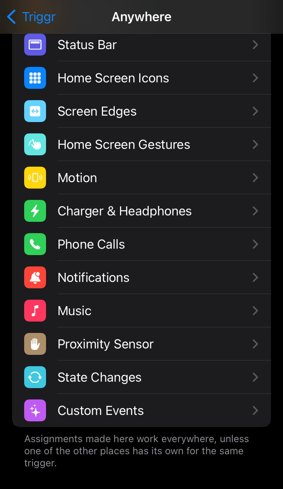
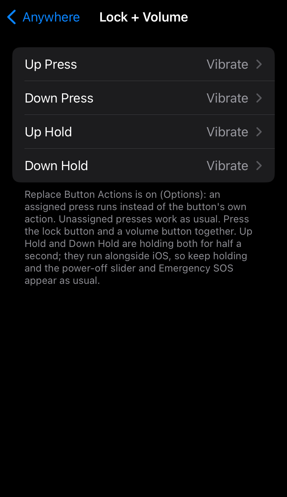
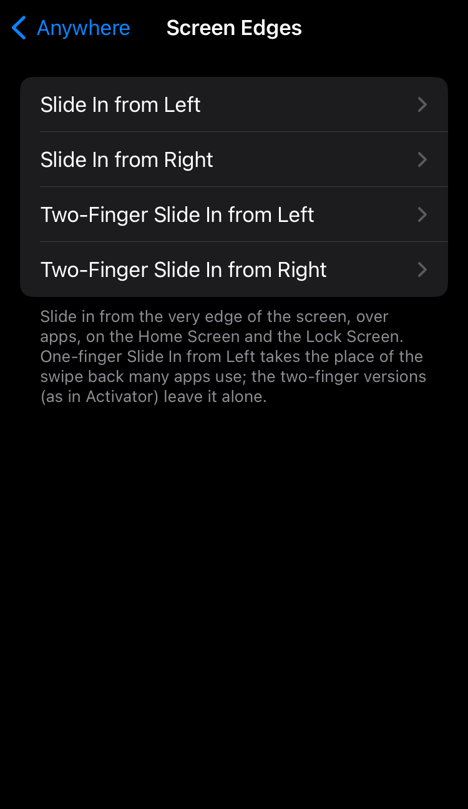
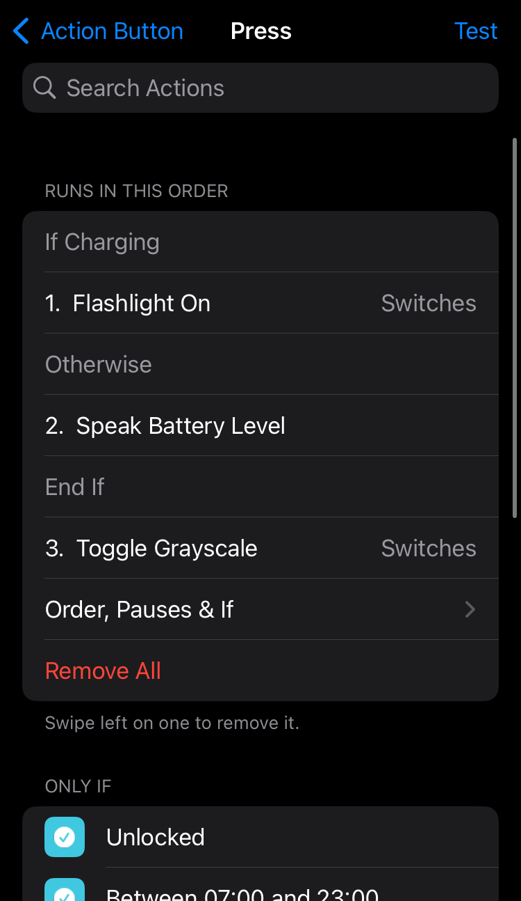
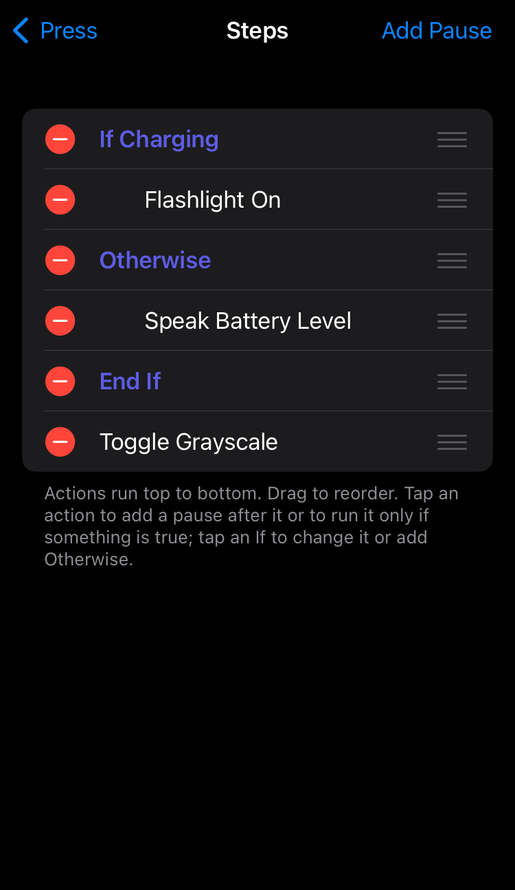
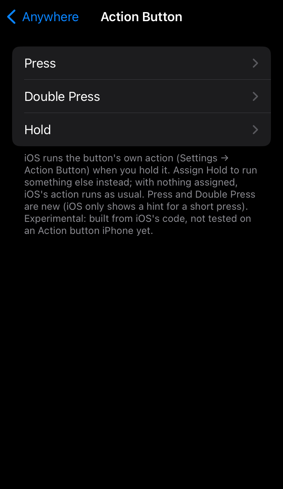

# Triggr — beta builds and feedback

> **This repo is for Triggr beta builds and beta feedback.** The current release's source, documentation and
> issues live in **[Jond-ie/triggr](https://github.com/Jond-ie/triggr)**. Install Triggr from
> **[John's Repo](https://jond-ie.github.io/repo/)**. The source folders here are from older betas.

**Triggr** is an Activator-style trigger tool for rootless jailbreaks (Dopamine) on **iOS 15–18**, arm64 and
arm64e. Assign actions to buttons, screen edges, the status bar, Home Screen gestures, sensors and events.

The goal: **the lightest trigger tool there is.** The main library loads into SpringBoard only, and nothing runs
for a trigger you haven't assigned: no timers, no polling, no extra daemons.

> AI assisted in development (Claude Code), all testing and debugging done by me on device.

## Current release: 1.5

  
  
  

New in 1.5:
- **Lock / Side + Volume:** press or hold the lock (side) button with Volume Up or Down. A press can replace the
  screenshot on Face ID iPhones; holding still brings up the power-off slider and Emergency SOS.
- **Screen edges:** slide in from the left or right edge, also with **two fingers** (like Activator), so apps keep
  their swipe back.
- **Phone calls** (incoming, answered, outgoing, ended), **music** (started, paused, song changed),
  **any notification**, **weekly schedules** and **Brightness Up / Down** steps.
- A Respring or Safe Mode run from a Volume Up trigger waits until you let go, so it can't land in Safe Mode.

Tested on A10 (iOS 15.8.6), A11 (iOS 16.7), A13 Face ID (iOS 16.2), A13 Touch ID (iOS 17.5.1) and
A13 Face ID (iOS 18.6.2).

**RootHide:** every release now comes with a RootHide build in the same GitHub release (the `_roothide_` .deb),
starting with [2.0 Beta 3](https://github.com/Jond-ie/triggr-beta/releases/tag/v2.0.0-beta3). Untested on a RootHide device; feedback welcome.

## Triggr 2.0 beta

**[Triggr 2.0 Beta 3](https://github.com/Jond-ie/triggr-beta/releases/tag/v2.0.0-beta3)** is out (also on the
Sileo repo). Every new feature costs nothing until you use it.

  
  
  
  
  

- **Fixed in Beta 3:** scheduled times run every day again (they could skip days while the phone slept), and
  multi-finger gestures no longer fire while typing fast.
- **New in Beta 2:** Snapper 3 and CopyLog actions (shown only while those tweaks are installed), contributed by
  [@qnblackcat](https://github.com/qnblackcat).
- **Only If:** conditions on any assignment (Wi-Fi network, charging, battery, time range, locked, and more), plus
  "still true after N seconds".
- **If / Otherwise steps** inside a sequence.
- **Multi-Finger Gestures** inside any app: two- and three-finger taps and swipes, pinch in / out.
- **Swipe Up from Bottom** left / middle / right.
- **Action Button** (iPhone 15 Pro and newer): experimental, untested on hardware. Reports wanted.
- **New actions:** Grayscale, Smart Invert, Classic Invert and Zoom switches; Speak Time / Battery / Clipboard,
  Clear Clipboard; Show Text.
- **[libtriggr](https://github.com/Jond-ie/libtriggr)** (MIT): other tweaks can add their own triggers, actions and a
  "Configure via Triggr" button. First user: **BegoneCIA 1.1.0** (On / Off / Toggle as Triggr actions).

From 2.0, Triggr is closed source; the 1.x source stays in [Jond-ie/triggr](https://github.com/Jond-ie/triggr).
Not planned on purpose: an always-on web server, background listeners or a bundled script interpreter.

## Bugs and feature requests

Please use **[Issues on Jond-ie/triggr](https://github.com/Jond-ie/triggr/issues/new/choose)**:
- **Crash report:** Triggr or SpringBoard crashed, or you hit safe mode. Include the crash log (Settings → Privacy &
  Security → Analytics & Improvements → Analytics Data) and your device, iOS and jailbreak.
- **Bug report:** something doesn't work as expected.
- **Feature request:** a trigger or action you want. If Activator had it, say so.

If anything ever puts you in safe mode, open Sileo (it still works there) and uninstall Triggr.

## License and credits

Source in this repo (older betas): GPL-3.0. Triggr 2.0+ is closed source; libtriggr is MIT. Original work by **John d_ie**, inspired by Activator (Ryan Petrich). App pickers by AltList (opa334).
